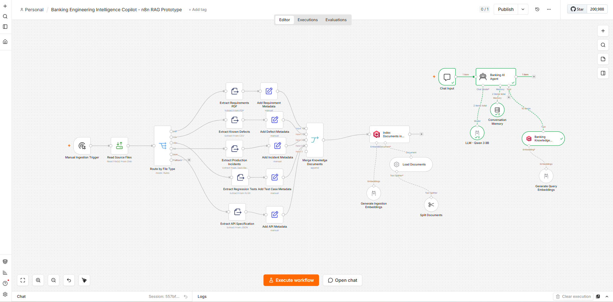

# Banking Engineering Intelligence Copilot

An n8n RAG prototype for retrieving context across banking software engineering documents: requirements, API specifications, regression tests, defects, and incidents.

**Status:** workflow prototype. This repository contains the n8n export, sample inputs, and screenshots. It does not contain a Python/FastAPI V2 implementation or a published retrieval-quality benchmark.

## Architecture



```text
Sample documents -> file routing and extraction -> metadata enrichment
                 -> document loading and chunking -> Ollama embeddings -> Qdrant

Chat input -> AI agent -> Qdrant retrieval tool -> context -> local Ollama LLM
```

The exported workflow specifies 800-character chunks with 150-character overlap, `nomic-embed-text:latest` embeddings, `qwen3:8b` for generation, and a retriever configured with `topK: 10`. These are the exported settings, not claims of optimal configuration.

## Repository contents

- [Workflow export](Workflow/Banking%20Engineering%20Intelligence%20Copilot%20-%20n8n%20RAG%20Prototype.json): import into n8n.
- [Sample-data](Sample-data/): PDF requirements, an OpenAPI JSON document, XLSX regression tests, CSV defects, and TXT incidents.
- [Ingestion screenshot](Screenshots/ingestion-pipeline.png).
- [Query screenshot](Screenshots/rag-query-pipeline.png).

## Local setup

You need an n8n installation that supports the node types in the export, a reachable Ollama server, and a reachable Qdrant instance. Versions are not pinned by this repository; importing the workflow may require adjusting nodes for your installed n8n version.

1. Clone this repository and start n8n, Ollama, and Qdrant according to their installation instructions.
2. Make the configured models available to Ollama:

   ```sh
   ollama pull nomic-embed-text:latest
   ollama pull qwen3:8b
   ```

   Check that your machine has enough memory for the generation model. Changing models requires updating the corresponding nodes.
3. Import the JSON file in `Workflow/` into n8n. Keep it inactive while configuring it.
4. Configure your own Ollama and Qdrant connections. Credential references in an export are not working credentials for your installation; supply local credentials where required.
5. The **Read Source Files** node uses `/files/*`. Make `Sample-data` available at that path inside the n8n process/container, or change the file selector to your actual data location. A path on your host is not automatically visible inside a container.
6. Review both Qdrant nodes. The exported collection value is `=banking_engineering_knowledge_v3`; verify how your n8n version evaluates that field and select the same actual collection for ingestion and retrieval. Its vector configuration must match the chosen embedding model.
7. Run the manual ingestion branch. Inspect extraction, metadata, and the inserted points before testing retrieval. Re-ingestion is not documented as idempotent; avoid blindly repeating it against a wanted collection.
8. Open the chat trigger's test interface and ask about the indexed sample documents. Inspect the agent's retrieval calls as well as its final answer.

## Questions to try

These are evaluation prompts, not recorded successful results:

- What acceptance criteria are stated for a requirement identifier found in the PDF?
- Which test cases concern a transfer rule described in the requirements?
- What does the OpenAPI document specify for a transfer operation?
- Is there supporting evidence for a relationship between a particular defect and an incident?
- What happens when a question has no support in the indexed documents?

Check answers against the original files. A proposed relationship between documents needs evidence; vector similarity alone does not establish it.

## Evaluation and limitations

No measured accuracy, retrieval recall, latency, or production-readiness claim is made. A reproducible evaluation should publish a question set, expected source passages, retrieval metrics, citation checks, and results for unsupported questions.

The prototype does not establish banking compliance, tenant isolation, production access controls, or robust document-injection resistance. Use permitted demonstration data and review documents and logs before publishing them. Local inference still requires securing the services and access to the indexed material.

[Montajab Al-Hussein](https://github.com/Montajab98) · [LinkedIn](https://www.linkedin.com/in/moontajab/)
